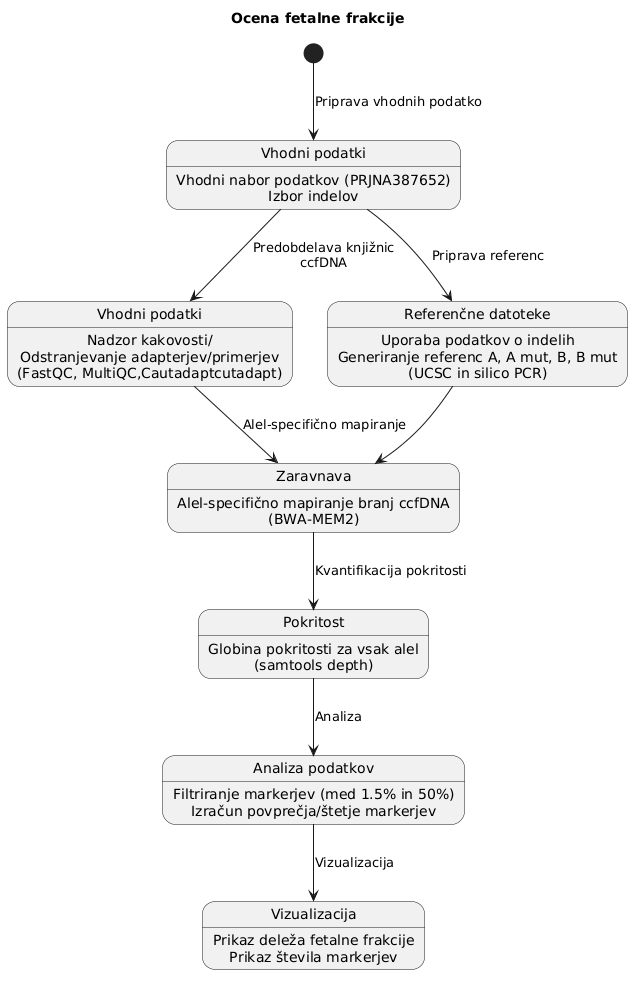
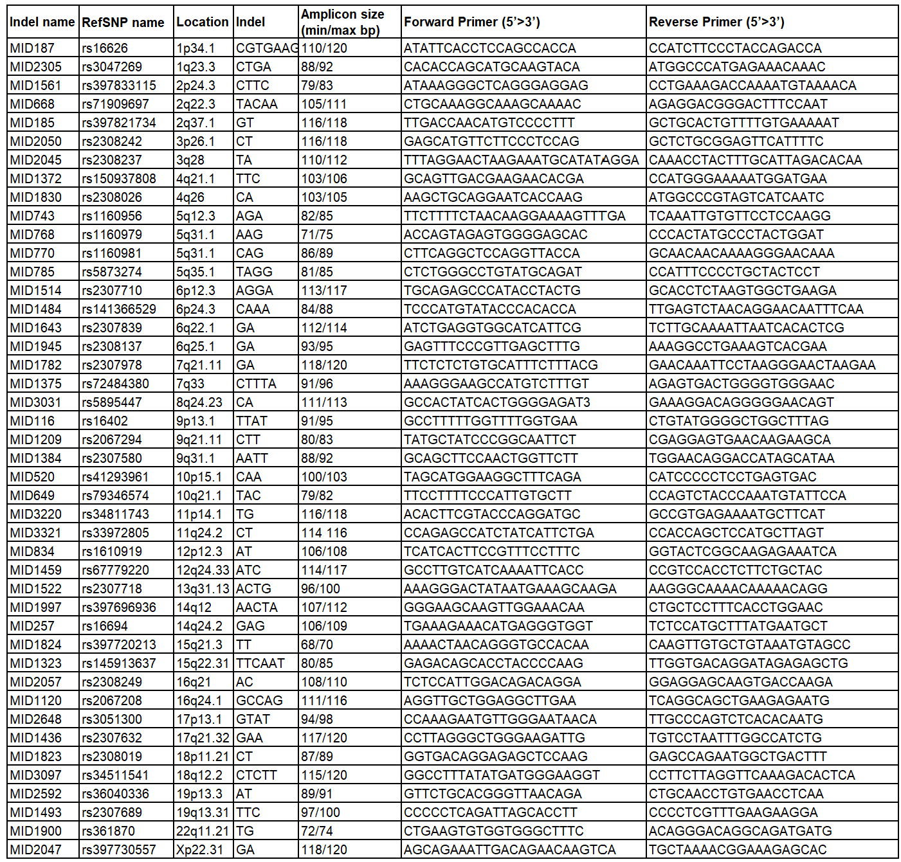
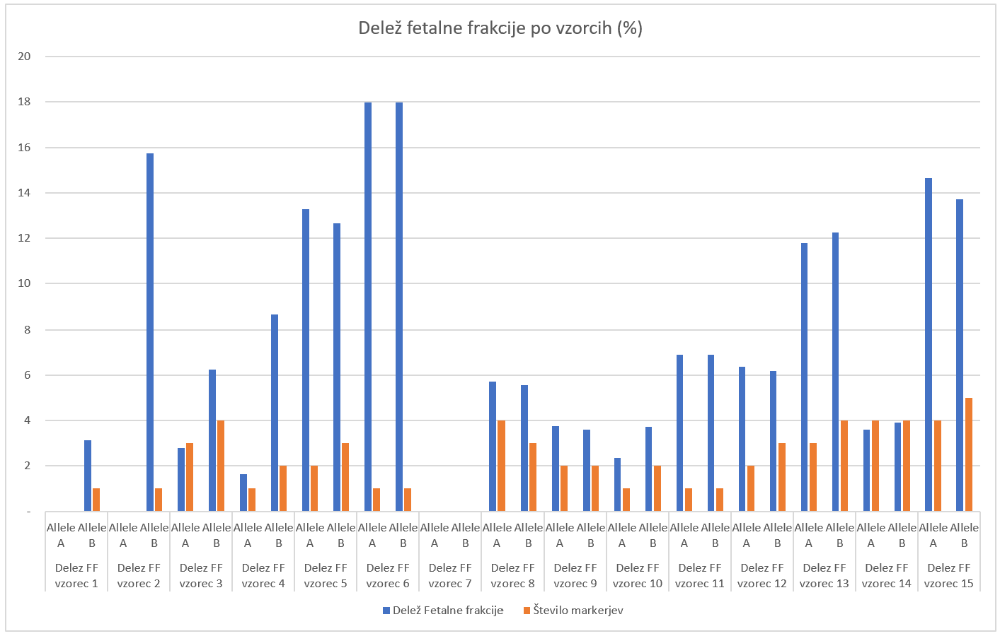

# Ocena-fetalne-frakcije
Ocena fetalne frakcije v prostoležeči DNA (cffDNA)

**Povzetek**
Razvoj bioinformatskega cevovoda za oceno deleža fetalne frakcije (FF) z uporabo informativnih markerjev iz vzorcev prostoležeče DNK (ccfDNA) v materini plazmi ter ovrednotiti zanesljivost rezultatov za klinično ali raziskovalno poročilo. Pri delu sem uporabil podatke iz sledečega projekta [1].

**Pristop**
Združevanje in obdelava genomskih podatkov za posamezne indele (alela A in B), filtriranje podatkov glede na stroge biološke kriterije ter hkratna vizualizacija vrednosti in statistične zanesljivosti.

# Ozadje in biološko-metodološko ozadje

**Metodologija izračuna**

Fetalna frakcija se za posamezni indel izračuna z upoštevanjem diploidne narave ploda (faktor 2) in razmerja med fetalnim alelom ter skupno pokritostjo

FF = 2 x (fetalni alel)/(skupna pokritost) 

**Kriterij informativnosti**
V analizi so bili kot veljavni (informativni) upoštevani le tisti markerji, katerih vrednost fetalne frakcije pade v biološko smiselen in zanesljiv razpon med 1,5 % in 50 %, s čimer se izločijo šumi in tehnične napake.

# Opis cevovoda (Workflow))
Celotni cevovod je prikazan na sliki 1

**Slika 1: Celoten potek obdelave**

## Priprava vhodnih vzorcev

Izbrane vhodne vzorce surovih branj sekvenciranja sem obdelal v skladu s priporočili za obdelavo bioinformatskih knjižnic. 
Predobdelava je obsegala sprotno preverjanje kakovosti po vsakem koraku, brisanje adapterjev, primerjev ter trimanje slabih baz z nizko kakovostjo. 
V začetno analizo je bilo zajetih 16 vzorcev ccfDNA. En vzorec ni preživel strogega filtriranja v začetnem delu cevovoda (zaradi neustrezne globine pokritosti ali tehničnih odstopanj), zato je bila končna kvantitativna analiza izpeljana na 15 vzorcih.
Uporabil sem orodja FastQC-MultiQC in cutadapt

[Končno poročilo kakovosti](https://droslj.github.io/Ocena-fetalne-frakcije-/MultiQC_final.html)

## Izdelava Referenčnih datotek

Kot osnova za mapiranje in pozicioniranje je bil uporabljen standardni človeški referenčni genom (GRCh37/hg19) in sicer referenčne fasta datoteke, ki so omejile analizo izključno na izbrane informativne markerje (in-del polimorfizme). 
Z izborom informativnih markerjev je računalniška učinkovitost bolj optimalna in cilja na izbrana mesta v genomu.

### Značilnosti markerjev

Analiza je temeljila na specifičnih insercijah in delecijah (InDelih) ter markerjih (označenih z ID-ji, npr. rs16626, rs3047269 itd. ter oznakami MID). Izbrani indeli služijo kot informativna okna, kjer je mati homozigotna, plod pa je od očeta podedoval alternativni alel. 
To omogoča neposredno merjenje prisotnosti plodove DNK v materini plazmi prek razmerja med branjem normalne in mutirane različice (z upoštevanjem diploidnega faktorja 2). Referenčne datoteke markerjev sem sestavil s pomočjo vhodnih tabel in orodja za kreiranje PCR markerjev [2]. 

**Tabela 1: Nabor izbranih markerjev**

[Markerji Alel A](Viri/allele_a.fasta)

[Markerji Alel A mutiran](Viri/allele_a_mutated.fasta)

[Markerji Alel B](Viri/allele_b.fasta)

[Markerji Alel B mutiran](Viri/allele_b_mutated.fasta)

## Zaravnava (Alignment)

Zaravnava je obsegal mapiranje branj prostoležeče DNK (ccfDNA) na referenčne fasta datoteke z uporabo visoko zmogljivega mapirnega orodja za kratka branja (BWA-MEM2). 

## Kvantifikacija alelov

Na dobljenih zaravnanih datotekah (.bam) sem opravil štetje globine pokritosti (read depth) in določanje števila branj za normalno (materino) in mutirano/fetalno verzijo na predhodno določenih mestih.

 
## Štetje in obdelava vzorcev
 
Za vsak vzorec sta bila analizirana alela A in B, končna fetalna frakcija pa je bila izračunana kot povprečje tistih markerjev, ki so padli v informativni razpon med 1,5 % in 50 %. 
Zanesljivost rezultatov je bila dodatno potrjena s štetjem veljavnih markerjev, kar omogoča razlikovanje med zanesljivimi vzorci (več markerjev) in tistimi z višjo statistično negotovostjo (npr. le 1 veljaven marker).    
  

 
 
**Slika 2: Fetalna frakcija in število markerjev** 

 
**Reference** 
[1] Cell-free DNA sequencing using insertion/deletion polymorphisms,  
    Project PRJNA387652 (https://www.ncbi.nlm.nih.gov/bioproject/PRJNA387652) 
[2] UCSC In-Silico PCR (https://genome.ucsc.edu/cgi-bin/hgPcr?hgsid=4224131935_t5LT9th8HArh20yQY4hvDEoUcgIp) 
